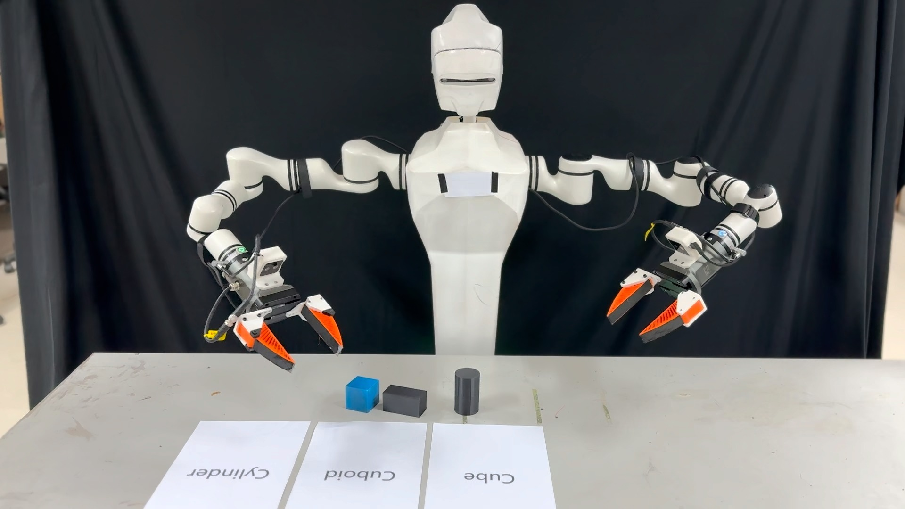

<h2>Chutian Qian</h2>

重庆三峡学院 · 软件开发 / 嵌入式 / 具身智能

 

<table>
  <tr>
    <td width="50%" valign="top">
      
    </td>
    <td width="50%" valign="top">
      <h3>π0.5 机械臂真机部署</h3>
      
在睿尔曼 RM65-B 双臂平台上部署 π0.5，独立完成数据采集、模型微调、真机部署和执行优化，实现按形状摆放和方块堆叠。

      
ROS 2 · π0.5 · RM65-B

      
<a href="https://www.bilibili.com/video/BV1PS4q6UE69/">摆放任务</a> · <a href="https://www.bilibili.com/video/BV1PQ4q67Ewm/">堆叠任务</a>

    </td>
  </tr>
  <tr>
    <td width="50%" valign="top">
      <!-- 封面： -->
      <h3><a href="https://github.com/qlqqs/ROOMusic">ROOMusic</a></h3>
      
自托管的私人音乐库，按专辑、版本、碟和曲目整理音乐，支持无损播放、歌词同步和多人使用。

      
Go · PostgreSQL · React · TypeScript

    </td>
    <td width="50%" valign="top">
      <!-- 封面： -->
      <h3><a href="https://github.com/qlqqs/STM32-OLED-SSD1306-I2C-HAL">STM32 OLED 驱动</a></h3>
      
0.96 寸 SSD1306 OLED 的 HAL 库驱动，支持硬件和软件 I2C，基于 zeruns 的版本升级到江协科技 v2.0。

      
C · STM32 HAL · I2C

    </td>
  </tr>
</table>

 

<a href="mailto:github@qlqqs.com">github@qlqqs.com</a>

